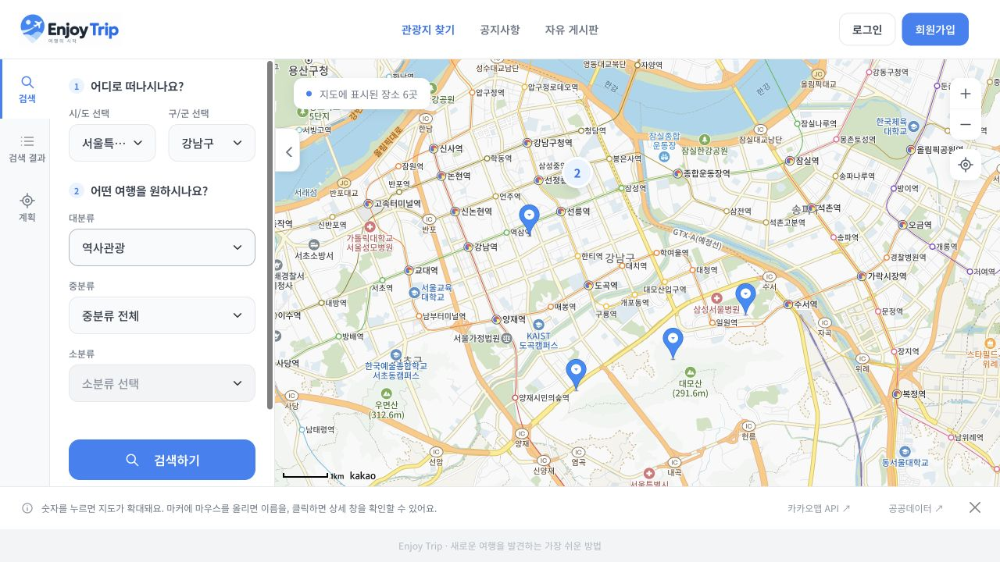
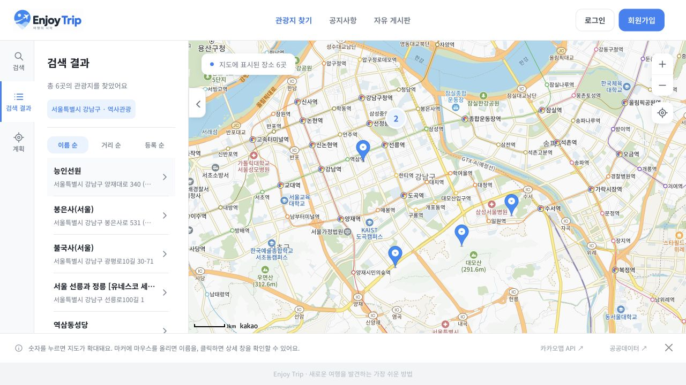
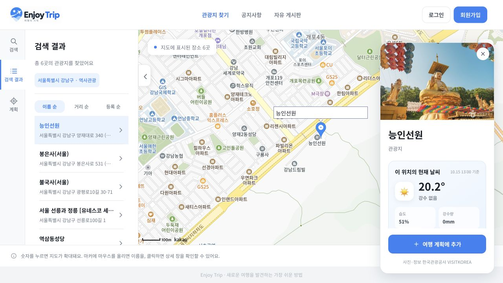
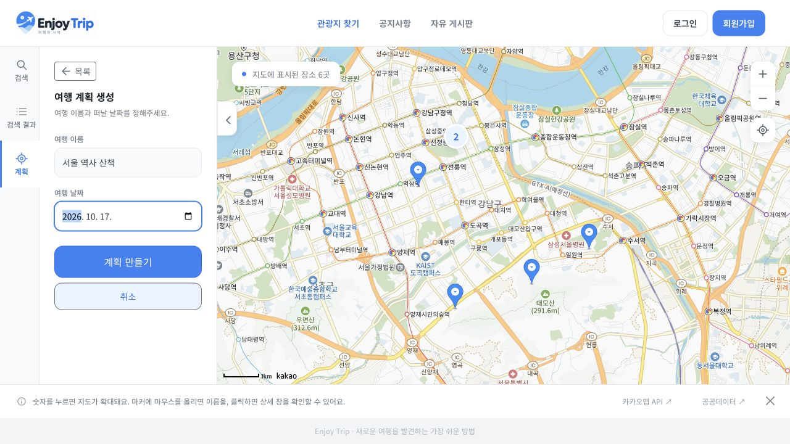
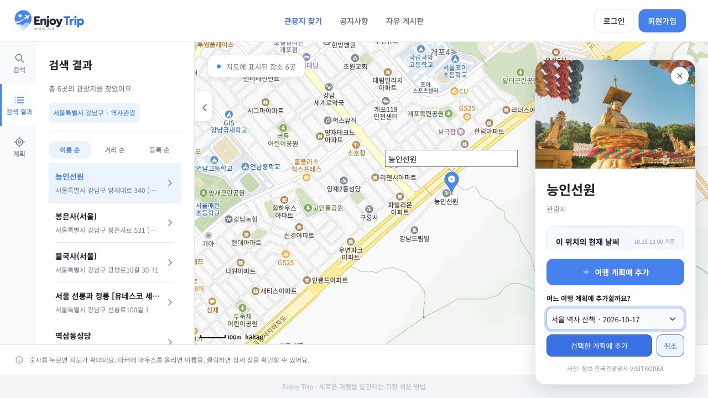
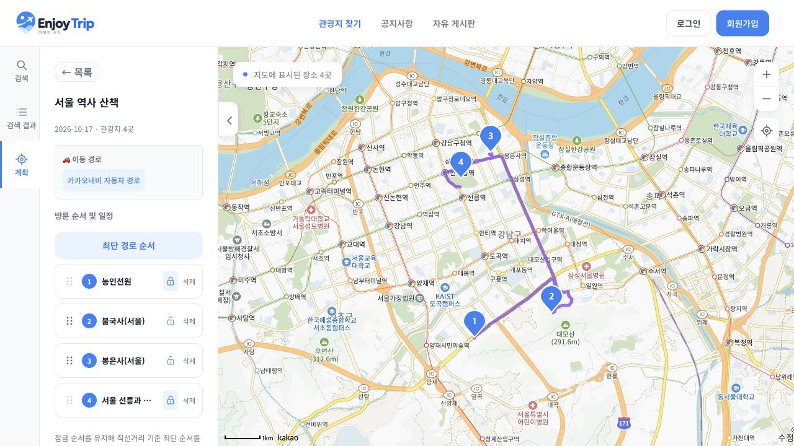
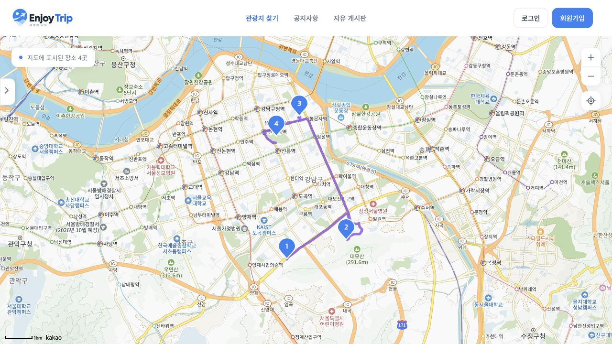
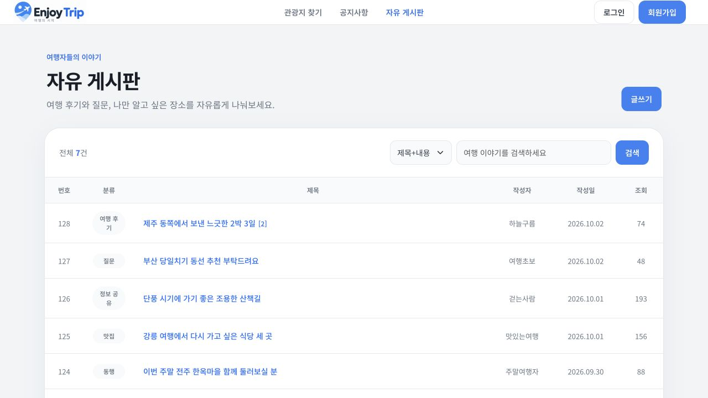
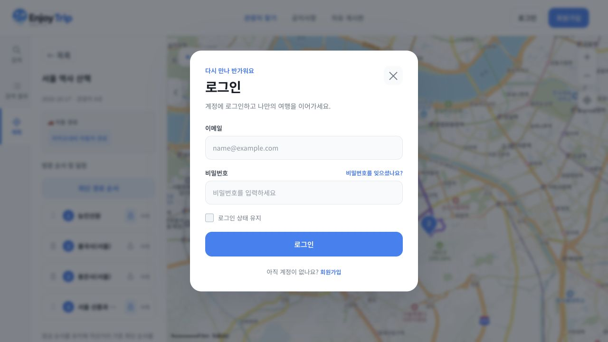

# Enjoy Trip · 푸른 하늘 여행

관광지를 지도와 검색 목록에서 탐색하고, 상세 정보와 현재 날씨를 확인한 뒤 나만의 여행 계획에 담는 프론트엔드 프로젝트입니다. 방문 순서를 직접 바꾸거나 잠금 조건을 유지한 최단 방문 순서를 계산할 수 있습니다. 한국관광공사·카카오·기상청 API를 연동하며, 공지사항과 자유 게시판, 회원 관리 기능을 제공합니다.

HTML, CSS, JavaScript ES Modules와 Bootstrap으로 구현했습니다. 별도의 백엔드나 빌드 과정 없이 정적 HTTP 서버에서 실행합니다.

## 주요 기능

별도 표시가 없는 소스 경로는 실행 기준 폴더인 `FE_08_Proj_lab/` 내부를 기준으로 합니다.

| 기능 | 페이지 / 화면 | 구현 내용 |
| --- | --- | --- |
| 관광지 탐색 | `pages/map.html` 검색 탭 | 시·도 / 구·군 및 대·중·소분류 검색, 현재 위치 반경 2km 검색, 지도 중심 재검색 |
| 검색 결과 목록 | 지도 왼쪽 검색 결과 탭 | 이름·주소 표시, 이름 순 / 내 위치 거리 순 / 계획 등록 순 정렬, 목록과 지도 선택 연동 |
| 지도 | 관광지 검색 결과 | 마커 클러스터링, 확대·축소, 전체 장소 보기, 긴 마커 제목 말줄임 |
| 메뉴 접기·펼치기 | 지도 왼쪽 메뉴 | PC 경계 화살표·모바일 상단 버튼, 지도 영역 확장, 선택 탭·입력값 유지 |
| 관광지 상세 | 마커 클릭 시 오른쪽 패널 | 사진, 소개, 주소, 이용시간, 문의, 유형별 상세 안내, 현재 날씨 |
| 여행 계획 | 지도 왼쪽 계획 탭 | 이름·날짜로 계획 생성, 계획 선택 후 장소 추가, 중복 방지, 개별 장소 및 계획 삭제 |
| 방문 순서 편집 | 저장된 계획 상세 | 손잡이 드래그·키보드로 순서 변경, 장소별 순서 잠금, 저장 및 새로고침 후 유지 |
| 최단 방문 순서 | 계획의 최단 경로 순서 버튼 | 위도·경도 거리 기준 16곳까지 정확 계산, 초과 시 모든 장소를 포함한 근사 계산 |
| 이동 경로 | 저장된 계획 상세 | 방문 번호 마커, 많은 경유지의 분할 조회, 순서 변경·장소 삭제 시 경로 갱신 |
| 회원 | 공통 헤더의 모달 | 회원가입, 로그인·로그아웃, 로그인 유지, 이름·이메일 확인을 통한 비밀번호 재설정 |
| 마이페이지 | `pages/my-page.html` | 이름 변경, 내 게시글·댓글 조회 및 관리, 회원 탈퇴 |
| 공지사항 | `pages/notice.html`, `pages/notice-detail.html` | 고정 공지, 검색, 페이지 이동, 상세 조회 |
| 자유 게시판 | `pages/free-board*.html` | 게시글 검색·작성·수정·삭제, 이미지 첨부, 댓글 작성·삭제 |

## 기술 및 디렉터리 구성

| 구분 | 사용 기술 |
| --- | --- |
| 화면 | HTML5, CSS3, Bootstrap 5, Noto Sans KR |
| 로직 | Vanilla JavaScript, ES Modules, Fetch API, AbortController, Web Worker, Pointer Events, ResizeObserver |
| 지도·경로 | Kakao Maps JavaScript SDK (`services`, `clusterer`), 카카오모빌리티 자동차 길찾기 API |
| 관광·날씨 | 한국관광공사 국문 관광정보 `KorService2`, 기상청 초단기실황 |
| 데이터 저장 | `localStorage`, `sessionStorage` |
| 개발·검증 | VS Code Live Server 또는 Python HTTP 서버, Node.js 기본 테스트 러너 |

현재 지도 페이지는 Bootstrap **5.3.8**, 게시판·마이페이지는 **5.3.3** CSS를 사용합니다. 각 페이지에서 Bootstrap 다음에 프로젝트 CSS를 불러옵니다.

```text
enjoytrip_03/                     # 저장소를 clone한 폴더
├── README.md
└── FE_08_Proj_lab/                # 실행 기준 폴더
    ├── config.env                # 직접 생성, Git 제외
    ├── index.html                # pages/map.html로 자동 이동
    ├── pages/                    # map, 게시판, 공지, 마이페이지, 공통 header/footer
    ├── css/                      # map.css, board.css, auth-modal.css, my-page.css
    ├── js/
    │   ├── keys.js               # config.env 로딩
    │   ├── map.js                # 검색 필터, 계획 저장, 순서·지도 갱신
    │   ├── search-results.js     # 검색 목록과 이름·거리·등록 순 정렬
    │   ├── sidebar.js            # 메뉴 접기·펼치기
    │   ├── kakao.js              # 지도 SDK, 클러스터, 방문 번호 마커
    │   ├── plan-sortable.js      # 드래그·키보드 순서 변경
    │   ├── route-optimizer.js    # 거리 계산, 정확·근사 방문 순서
    │   ├── route-job.js          # Worker 작업 시작·취소
    │   ├── route-worker.js       # 별도 스레드에서 순서 계산
    │   ├── car-route.js          # 자동차 경로 분할 조회 및 대체 연결
    │   ├── tour-detail-api.js    # 관광지 상세 API 호출
    │   ├── tour-detail.js        # 상세 패널 및 계획 선택 UI
    │   ├── weather.js            # 날씨 격자 변환, 조회, 캐시
    │   ├── common.js             # fetch / select 공통 함수
    │   ├── layout.js             # 공통 HTML include
    │   ├── my-page.js
    │   ├── auth/                 # 회원·인증·모달
    │   └── board/                # 게시글·댓글·공지
    ├── resources/                # 로고, 아이콘, 마커, 대체 이미지
    ├── docs/                     # 프로젝트 명세서, 디자인 가이드, screenshots/
    └── tests/                    # 검색·정렬·상세·계획·순서 계산·경로·마커 테스트
```

## 환경 설정 및 실행

### 1. 프로젝트 준비

실행 명령과 `config.env` 위치는 **`pages/`, `js/`, `css/`가 있는 `FE_08_Proj_lab` 폴더**를 기준으로 합니다. 최신 브라우저와 인터넷 연결이 필요합니다. Bootstrap·글꼴·지도 SDK는 외부에서 불러오며, `npm install`이나 빌드는 필요하지 않습니다.

### 2. `config.env` 작성

실행 기준 폴더에 아래 이름으로 파일을 만들고 각 값을 발급받은 키로 바꿉니다.

```dotenv
DATA_GO_KR_API_KEY=YOUR_TOUR_API_SERVICE_KEY
KAKAO_MAP_KEY=YOUR_KAKAO_JAVASCRIPT_KEY
KAKAO_REST_API_KEY=YOUR_KAKAO_REST_API_KEY
KMA_SERVICE_KEY=YOUR_KMA_SERVICE_KEY
```

| 변수명 | 입력할 키 | 사용 기능 | 필수 여부 |
| --- | --- | --- | --- |
| `DATA_GO_KR_API_KEY` | 공공데이터포털의 한국관광공사 국문 관광정보 서비스 인증키 | 지역·분류 목록, 관광지 검색, 상세·사진 조회 | 필수 |
| `KAKAO_MAP_KEY` | 카카오디벨로퍼스 **JavaScript 키** | 지도 SDK, 마커·클러스터, 주소 좌표 검색 | 필수 |
| `KAKAO_REST_API_KEY` | 카카오디벨로퍼스 **REST API 키** | 카카오모빌리티 자동차 길찾기 | 선택: 없거나 요청 실패 시 장소를 직선으로 연결 |
| `KMA_SERVICE_KEY` | 공공데이터포털의 기상청 단기예보 조회서비스 인증키 | 관광지 위치의 현재 날씨 | 선택: 없으면 상세 패널에 설정 안내 표시 |

- 공공데이터포털에서 [한국관광공사 국문 관광정보 서비스](https://www.data.go.kr/data/15101578/openapi.do)와 [기상청 단기예보 조회서비스](https://www.data.go.kr/data/15084084/openapi.do)를 각각 활용 신청합니다. 같은 인증키를 사용하더라도 각 서비스의 사용 권한을 확인해야 합니다.
- `DATA_GO_KR_API_KEY`에는 **Decoding 인증키**를 입력합니다. 코드가 `URLSearchParams`로 인코딩하므로 이미 인코딩한 값을 넣으면 인증이 실패할 수 있습니다. `KMA_SERVICE_KEY`도 Decoding 인증키를 권장하며, 현재 날씨 모듈은 Encoding 키도 한 번 디코딩합니다.
- 카카오 키는 [카카오디벨로퍼스](https://developers.kakao.com/)에서 앱을 만들고 확인합니다. 지도에는 JavaScript 키, 길찾기에는 REST API 키를 사용합니다. 길찾기 서비스 설정은 [카카오모빌리티 시작하기](https://developers.kakaomobility.com/guide/navi-api/start.html)를 참고합니다.
- `js/keys.js`가 `config.env`를 `fetch()`로 읽은 뒤 다른 모듈이 실행됩니다. OS 환경변수나 `dotenv` 패키지를 사용하는 구조가 아닙니다. **현재 실제 파일명은 `config.env`**이며, 일부 기존 주석·오류 문구에 나오는 `.env`와 구분해야 합니다.
- `config.env`는 Git에서 제외됩니다. 다만 정적 서버에서는 브라우저가 파일과 키를 읽을 수 있으므로 비밀 저장소가 아닙니다. 운영 환경에서는 비밀 키가 필요한 호출을 서버로 옮기고 API 제공자의 도메인·호출 제한 정책을 적용해야 합니다.

### 3. 카카오 지도 도메인 등록

카카오디벨로퍼스의 앱 설정에서 사용할 JavaScript 키의 **JavaScript SDK 도메인**에 실제 실행 주소를 등록합니다. 현재 개발 포트는 **5500**입니다. [공식 지도 시작 가이드](https://apis.map.kakao.com/web/guide/)

```text
http://127.0.0.1:5500
http://localhost:5500
```

두 주소를 번갈아 사용할 경우 모두 등록합니다. 포트를 바꾸면 등록 주소도 맞춰야 합니다. 브라우저 저장소는 주소별로 구분되므로 개발 중에는 한 주소를 계속 사용하는 것이 좋습니다.

### 4. VS Code Live Server로 실행

1. VS Code에서 실행 기준 폴더 `FE_08_Proj_lab`을 엽니다.
2. 확장 **Live Server (Ritwick Dey)**를 설치합니다.
3. `index.html`을 열고 우클릭 → **Open with Live Server**를 선택합니다.
4. `http://127.0.0.1:5500/`에서 자동으로 `pages/map.html`로 이동합니다. 지도 페이지를 직접 열어도 됩니다.

포트를 명시하려면 VS Code 작업 영역 설정에 아래 값을 사용합니다. [Live Server 설정 문서](https://github.com/ritwickdey/vscode-live-server/blob/master/docs/settings.md)

```json
{
  "liveServer.settings.port": 5500,
  "liveServer.settings.host": "127.0.0.1"
}
```

저장소의 상위 폴더를 서버 루트로 열었다면 주소는 `/FE_08_Proj_lab/pages/map.html`이 됩니다. 이 README의 예시 주소와 동일하게 실행하려면 내부 `FE_08_Proj_lab` 폴더를 서버 루트로 사용합니다.

### 5. Python으로 실행하는 대안

Python 3가 설치되어 있다면 같은 폴더에서 실행합니다.

```sh
python3 -m http.server 5500 --bind 127.0.0.1
```

브라우저에서 `http://127.0.0.1:5500/`을 엽니다. `index.html`이 `pages/map.html`로 자동 이동하며, 지도 페이지 주소로 직접 접속해도 됩니다. Live Server와 Python 서버 중 하나만 사용하고, 종료할 때는 터미널에서 `Ctrl+C`를 누릅니다.

HTML 파일을 더블클릭한 `file://` 실행은 모듈과 설정 파일 로딩에 적합하지 않습니다. 내 주변 검색과 검색 결과의 거리 순 정렬에는 브라우저 위치 권한이 필요하며, HTTPS 또는 localhost/127.0.0.1 환경에서 사용합니다.

## 사용 흐름

1. **검색** 탭에서 지역·분류를 선택하거나 **내 주변 검색**을 누릅니다. 조회가 완료되면 **검색 결과** 탭이 열립니다.
2. 목록을 **이름 순·거리 순·등록 순**으로 정렬합니다. 거리 순은 현재 위치를 요청하고, 등록 순은 이 브라우저의 여행 계획에 포함된 횟수를 사용합니다.
3. 목록 항목이나 지도 마커를 눌러 사진·소개·방문 정보·현재 날씨를 확인합니다. 상세 패널을 연 상태에서도 지도와 왼쪽 메뉴를 사용할 수 있고, 패널은 X 버튼으로 닫습니다.
4. **계획 → 여행 계획 생성**에서 이름과 날짜를 입력합니다. ID는 자동 생성되며 설명은 빈 값으로 저장됩니다.
5. 관광지 상세의 **여행 계획에 추가 → 계획 선택 → 선택한 계획에 추가**를 누릅니다. 검색 마커를 유지하며 여러 관광지를 계속 추가할 수 있습니다.
6. 저장된 계획을 열어 손잡이를 드래그하거나 손잡이에 초점을 두고 위·아래 방향키, Home, End로 방문 순서를 바꿉니다. 장소의 잠금 버튼을 누르면 현재 방문 번호가 고정됩니다.
7. 출발·도착지를 고정하려면 각각 첫 번째·마지막 장소를 잠근 뒤 **최단 경로 순서**를 누릅니다. 바뀐 순서가 저장되고 방문 번호와 지도 경로도 갱신됩니다.
8. 지도를 넓게 보려면 PC에서는 메뉴 경계 화살표, 모바일에서는 상단 **메뉴 접기·펼치기** 버튼을 사용합니다. 다시 펼쳐도 탭과 작성 중인 내용이 유지됩니다.
9. 자유 게시판의 글쓰기·댓글과 마이페이지는 이 브라우저에서 회원가입·로그인한 후 이용합니다.

## 구현 특징

### 관광지 조회와 지도

- `numOfRows=100`은 **한 번의 API 요청 크기**입니다. `pageNo`를 증가시키며 전체 결과를 모아 지도에 표시하므로 총 결과를 20개 또는 100개로 제한하지 않습니다.
- Kakao `MarkerClusterer`가 인접한 마커를 묶습니다. 상위 지역·분류 변경 시 하위 선택을 초기화하고, 좌표가 유효한 장소를 지도에 표시합니다.
- 내 주변 검색은 현재 위치와 선택한 관광 분류를 사용합니다. 위치 권한 거절·시간 초과·검색 결과 없음은 안내 문구로 구분하고 지도 중심 조회를 제공합니다.

### 검색 결과 정렬

- `sortSearchResults()`가 정렬용 임시 배열을 만들어 비교 정렬하므로 원본 검색 결과나 저장된 계획의 순서는 바뀌지 않습니다.
- **이름 순:** `localeCompare`의 한국어 로케일과 `{ numeric: true }` 옵션으로 한국어 이름과 포함된 숫자를 비교합니다. 새 검색의 기본값입니다.
- **거리 순:** Geolocation으로 현재 위치를 새로 받아 Haversine 공식으로 계산한 거리의 오름차순으로 정렬합니다. 좌표를 사용할 수 없는 장소는 뒤로 보냅니다. 권한 거부·위치 확인 실패 시 기존 정렬을 유지합니다.
- **등록 순:** 저장된 계획마다 `Set`으로 중복을 제거한 뒤 `Map`으로 포함된 계획 수를 집계해 내림차순으로 정렬합니다. 한 계획 안에서 같은 장소는 한 번만 셉니다. 전체 사용자 인기 순위나 API 등록일 순서가 아닙니다.
- 거리·등록 수가 같으면 이름 순으로 비교합니다. 계획 변경 시 등록 수를 갱신하고, 늦게 도착한 위치 응답이 새 정렬이나 검색 결과를 덮어쓰지 않도록 요청 버전을 확인합니다.

### 상세 패널과 여행 계획

- `detailCommon2`, `detailIntro2`, `detailInfo2`, `detailImage2`를 조합해 관광 유형에 맞는 정보를 구성합니다. 일부 API가 실패해도 성공한 내용은 표시합니다.
- 다른 마커를 선택하거나 패널을 닫으면 기존 요청을 취소하고, 늦게 도착한 응답이 새 관광지 정보를 덮어쓰지 않도록 요청 순서를 확인합니다.
- 사진이 없거나 로드에 실패하면 `resources/img/placeholder.png`를 사용합니다.
- Bootstrap 탭·Collapse로 검색 / 검색 결과 / 계획 / 생성 화면을 전환하고, Offcanvas 기반 상세 패널은 배경 지도 조작을 허용합니다.
- 여행 계획은 `localStorage`의 `myTripPlans`에 저장합니다. 장소 추가 시 관광지 ID 또는 이름·좌표로 중복을 검사하며, 저장 성공 후 목록을 갱신합니다.
- 손잡이의 실제 드롭 위치에 따라 순서를 변경하고, 잠긴 장소의 위치는 유지합니다. 변경한 순서와 잠금은 저장되며 새로고침 후에도 유지됩니다.
- 저장 성공 후 방문 목록과 번호 마커·경로를 갱신합니다. 저장 실패나 다른 탭의 변경을 확인하여 기존 계획을 무심코 덮어쓰지 않도록 합니다.

### 최단 방문 순서와 자동차 경로

관광지 사이의 위도·경도로 Haversine 거리를 구합니다. 순서 계산 자체는 외부 API를 호출하지 않으며, 출발지로 복귀하지 않는 경로를 대상으로 합니다.

| 전체 관광지 수 | 계산 방법 | 적용 범위 |
| --- | --- | --- |
| 16곳 이하 | Held–Karp 방식의 비트마스크 동적 계획법 | 잠금 조건 아래 총 좌표 거리를 최소화하는 정확 계산 |
| 16곳 초과 | 최대 4개 출발 후보의 최근접 이웃 탐색 + 2-opt + 두 장소 교환 | 모든 관광지와 잠금을 유지하는 근사 계산, 전역 최단 순서는 보장하지 않음 |

- 잠금은 현재 방문 번호를 고정합니다. 첫·마지막 장소를 잠그면 출발·도착지가 고정되며 중간 장소도 잠글 수 있습니다. 잠그지 않은 출발·도착지는 계산에 따라 달라질 수 있습니다.
- 근사 계산은 개선 탐색을 최대 12회·200만 위치 쌍 평가로 제한하며 관광지 목록은 자르지 않습니다. 최종 거리가 충분히 줄지 않으면 기존 순서를 유지합니다. 좌표가 잘못된 장소가 있으면 전체 계산을 중단해 누락을 방지합니다.
- 순서 계산은 Web Worker에서 수행하고, 계획 전환·장소 변경·잠금 변경 시 계산을 취소합니다. 완료된 결과도 현재 계획과 비교해 오래된 결과의 반영을 막습니다.
- 순서가 확정되면 카카오모빌리티 자동차 길찾기로 지도에 표시할 경로를 조회합니다. 요청마다 **출발·도착지 + 경유지 최대 5개**를 사용하고, 인접 요청의 끝·시작점을 공유해 8곳 이상도 모든 방문지를 연결합니다. [자동차 길찾기 API 문서](https://developers.kakaomobility.com/guide/navi-api/directions)
- 자동차 경로 요청 실패·키 누락 시 해당 구간을 직선으로 연결하고 대체 경로임을 표시합니다. 장소 삭제나 화면 전환 이후 도착한 과거 경로는 다시 그리지 않습니다.

구현은 [목록 정렬](FE_08_Proj_lab/js/search-results.js), [방문 순서 계산](FE_08_Proj_lab/js/route-optimizer.js), [자동차 경로 조회](FE_08_Proj_lab/js/car-route.js)에서 확인할 수 있습니다.

### 메뉴 접기·펼치기

- Bootstrap Collapse로 왼쪽 메뉴 전체를 숨기고 다시 표시합니다. PC에서는 메뉴와 지도 경계에 화살표, 모바일에서는 상단에 텍스트 버튼을 배치합니다.
- 메뉴를 접으면 지도 영역이 늘어나고, `ResizeObserver`가 지도 크기를 갱신하면서 지도 중심을 유지합니다.
- 메뉴의 DOM을 유지하므로 선택한 탭·계획·입력값이 보존됩니다. 숨긴 메뉴는 키보드 탐색에서 제외하고 버튼의 접근성 상태도 갱신합니다.
- 메뉴 동작은 별도 `sidebar.js`로 실행하므로 관광 API나 지도 SDK의 로딩 성공 여부에 의존하지 않습니다.

### 현재 날씨

- 관광지 위·경도를 기상청 **5km 격자 좌표**로 변환해 초단기실황 `getUltraSrtNcst`를 조회합니다.
- 기온, 강수 형태, 습도, 1시간 강수량, 풍향·풍속과 관측 기준 시각을 보여줍니다.
- 자료 제공 지연을 고려해 현재 시각보다 40분 이전의 정시를 요청하고, 격자·관측시각별 결과를 `sessionStorage`에 **10분간 캐시**합니다.
- 현재 관측 날씨이며, 여행 계획 날짜의 미래 예보를 제공하는 기능은 아닙니다.

### 회원·커뮤니티·디자인

- 회원정보, 게시글, 댓글은 브라우저에 저장합니다. 로그인 유지 선택에 따라 현재 사용자 정보를 `localStorage` 또는 `sessionStorage`에 저장합니다.
- 비밀번호는 Web Crypto의 PBKDF2 / SHA-256과 사용자별 salt로 처리합니다. 이름·이메일 기반 비밀번호 재설정과 회원 관리도 브라우저 내부에서 동작하는 학습용 구현입니다.
- 게시판은 샘플 공지·게시글을 초기화하고 검색, 페이지 이동, 작성자에 따른 수정·삭제 기능을 제공합니다. 첨부 이미지는 최대 3장, 파일당 700KiB로 제한합니다.
- Bootstrap 반응형 레이아웃 위에 파란색 `#3182F6`, 배경 `#F2F4F6`, 본문 `#191F28`과 Noto Sans KR을 적용합니다. 공통 헤더·푸터는 `data-include`로 재사용합니다.

## 실행 결과

2026년 10월 15일, `http://127.0.0.1:5500`에서 현재 버전을 실행해 촬영한 화면입니다. 관광지 정보·사진, 지도, 날씨, 자동차 경로는 실제 API 응답을 사용했으며 조회 시점에 따라 달라집니다. 여행 계획은 촬영용 예시이고, 게시판은 초기 샘플 데이터입니다.

### 관광지 검색 및 마커 클러스터

서울특별시 강남구의 역사관광 검색 결과 6곳입니다. 가까운 마커는 클러스터로 묶어 표시합니다.



### 검색 결과 목록 및 정렬

검색 결과 탭에서 관광지 이름과 주소를 확인하고 이름 순·거리 순·등록 순을 선택할 수 있습니다. 거리 순은 현재 위치, 등록 순은 현재 브라우저에 저장된 여행 계획의 장소 등록 횟수를 기준으로 합니다.



### 관광지 상세 및 현재 날씨

능인선원의 사진과 관광지 정보, 기상청 초단기실황을 오른쪽 상세 패널에서 확인합니다.



### 여행 계획 생성

이름과 날짜를 입력해 여행 계획을 생성합니다. 아래 화면은 촬영용 계획인 ‘서울 역사 산책’의 입력 예시입니다.



### 장소를 추가할 계획 선택

상세 패널에서 저장 대상 계획을 선택한 뒤 해당 장소를 추가합니다.



### 방문 순서·잠금 및 자동차 경로

관광지 4곳을 담은 계획에 드래그 손잡이, 순서 잠금, ‘최단 경로 순서’ 버튼을 표시합니다. 아래 화면은 첫 장소와 마지막 장소를 잠근 뒤 좌표 거리 기준으로 최단 순서를 적용한 결과입니다. 지도에는 갱신된 방문 번호와 카카오내비 자동차 경로가 표시됩니다.



### 왼쪽 메뉴 접기

메뉴를 접으면 지도가 넓어지고, 방문 번호와 이동 경로는 유지됩니다. 지도 왼쪽 화살표로 메뉴를 다시 펼칠 수 있습니다.



### 자유 게시판

분류·작성자·조회수·댓글 수를 표시하고, 제목·내용·작성자 기준 검색을 제공합니다.



### 로그인

공통 헤더에서 로그인 모달을 열고 회원가입·비밀번호 재설정으로 이동합니다.



## 검증 및 현재 범위

Node.js의 기본 테스트 러너를 사용합니다. 실행 기준 폴더에서 다음 명령을 실행합니다.

```sh
# 전체 테스트
node --test tests/*.test.js

# 검색 정렬 / 방문 순서 / 계획 저장 / 자동차 경로 테스트
node --test tests/search-results.test.js tests/route-optimizer.test.js tests/trip-plan.test.js tests/car-route.test.js

# JavaScript 문법 검사 (macOS / Linux / Git Bash)
for file in js/*.js js/auth/*.js js/board/*.js; do
  node --input-type=module --check < "$file" || exit 1
done
```

이번 문서 갱신 시 전체 **71개 테스트 통과**와 위 JavaScript 문법 검사 통과를 확인했습니다. 주요 검증 범위는 다음과 같습니다.

- 검색 결과 이름·거리·등록 순 정렬, 위치 권한 실패와 늦은 응답 처리.
- 정확 계산과 완전 탐색 결과의 비교, 16/17곳의 계산 방식 경계, 100·600곳의 관광지·잠금 보존.
- 변경 순서와 잠금의 저장, 새로고침 후 복원, 저장 실패 시 기존 상태 보존.
- 번호 마커 갱신, 자동차 경로 분할·대체 연결, 이전 요청·계산 취소.

자동 테스트는 가상 API·저장소·지도 SDK 등을 사용합니다. 실제 키의 유효성, API 사용 승인·할당량, 브라우저 위치 권한은 실행 환경에서 별도로 확인해야 합니다. 실행 환경에서 1440px·820px·390px 화면의 메뉴 접기·펼치기, 입력값 유지, 드래그·키보드 이동도 수동으로 확인하세요.

- 백엔드·데이터베이스가 없으므로 회원·게시글·계획은 같은 브라우저와 같은 출처에서만 유지되며, 다른 기기와 공유되지 않습니다. 여행 계획은 현재 사용자별로 분리되지 않습니다.
- 최단 순서는 좌표 거리 기준입니다. 도로 구조·일방통행·교통량을 반영한 실제 운전 거리나 시간의 최적 순서를 보장하지 않으며, 16곳 초과 계산은 근사 결과입니다.
- 로그인·권한 판정과 비밀번호 재설정은 서버 인증·이메일 검증을 대체하지 않습니다. 실제 서비스 전환 시 서버 인증, 사용자별 저장소, API 프록시가 필요합니다.
- 기상청 날씨와 회원·게시판 전체 동작을 검증하는 자동화 테스트는 아직 없습니다.

## 실행 중 문제가 생기면

| 증상 | 확인할 사항 |
| --- | --- |
| 첫 화면이 열리지 않음 | 서버 루트가 내부 `FE_08_Proj_lab`인지 확인하고 `/pages/map.html`에 직접 접속. `index.html`은 지도 페이지로 자동 이동 |
| 키 파일 로딩 실패 | `config.env`가 `js/`와 같은 실행 기준 폴더에 있는지, HTTP 서버로 열었는지 확인 |
| 지도가 나오지 않음 | JavaScript 키 종류와 실제 접속 도메인·포트의 카카오 등록 여부 확인 |
| 관광지 조회 인증 오류 | 해당 서비스 활용 승인과 `DATA_GO_KR_API_KEY`의 Decoding 값 확인 |
| 날씨가 안 나옴 | `KMA_SERVICE_KEY`, 기상청 단기예보 사용 승인, 관측 자료 제공 상태 확인 |
| 경로가 직선으로 표시됨 | REST API 키, 카카오모빌리티 서비스 설정 및 응답 상태 확인 |
| 내 주변 조회 또는 거리 순 정렬 실패 | HTTPS 또는 localhost/127.0.0.1 접속과 위치 권한 확인. 거리 순 실패 시 기존 정렬 유지, 내 주변 조회는 지도 중심 재검색으로 대체 가능 |
| 등록 순이 예상과 다름 | 현재 브라우저의 계획에 포함된 횟수 기준이며 같은 계획의 중복 장소는 한 번만 집계하는지 확인 |
| 최단 경로 순서 버튼이 비활성화됨 | 계획이 열려 있는지, 잠금 해제된 장소가 2곳 이상인지, 계산 중인지 확인 |
| 순서 계산이 중단됨 | 모든 장소에 유효한 좌표가 있는지 확인하고, 다른 탭에서 계획이 바뀌었다면 계획을 다시 열기 |
| 왼쪽 메뉴가 보이지 않음 | PC의 지도 왼쪽 화살표 또는 모바일 상단의 메뉴 펼치기 버튼 사용 |
| 저장한 계획·회원이 안 보임 | 사용한 브라우저, `localhost` / `127.0.0.1`, 포트가 이전과 같은지 확인 |
| 5500 포트 사용 중 | 이미 실행 중인 서버를 이용하거나 종료 후 재실행 |

키를 변경한 뒤에는 페이지를 새로고침합니다. 문제가 남으면 개발자 도구에서 오류를 확인하되, API 키가 포함된 요청 주소·설정 파일을 공유하지 않습니다.

프로젝트 요구사항은 [프로젝트 명세서](FE_08_Proj_lab/docs/enjoytrip.pdf), 디자인 참고 자료는 [디자인 가이드](FE_08_Proj_lab/docs/design.md)에서 확인할 수 있습니다. 디자인 가이드의 일부 파일 경로는 이전 구조를 기준으로 하므로 실행 경로는 이 README를 따릅니다.
