# EnjoyTrip · 회원·게시판 백엔드 프로젝트

한국관광공사의 관광정보를 지도에서 찾고 여행 계획을 구성하는 EnjoyTrip에 **회원·세션 인증·비밀번호 찾기·자유게시판**을 연결한 Java Servlet 프로젝트입니다. 프론트엔드는 **Live Server 5500**, 백엔드는 **STS에 등록한 Tomcat 11의 8080 포트**로 실행합니다.

> 회원·게시글은 메모리 DAO에 저장되며 서버 재시작·재배포 시 사라집니다. 여행 계획은 브라우저 localStorage에 저장됩니다. 현재 화면은 HTML/JavaScript와 JSON API로 연결되며 JSP 화면은 사용하지 않습니다.

## 목차

1. [프로젝트 개요](#1-프로젝트-개요)
2. [요구사항 목록](#2-요구사항-목록)
3. [Usecase Diagram과 Class Diagram](#3-usecase-diagram과-class-diagram)
4. [프로젝트 구조](#4-프로젝트-구조)
5. [환경 설정과 실행 · STS](#5-환경-설정과-실행--sts)
6. [회원가입과 비밀번호 찾기](#6-회원가입과-비밀번호-찾기)
7. [API 명세 요약](#7-api-명세-요약)
8. [실행 결과 · 스크린샷](#8-실행-결과--스크린샷)
9. [검증 결과와 테스트](#9-검증-결과와-테스트)
10. [문제 해결과 제출 자료](#10-문제-해결과-제출-자료)

## 1. 프로젝트 개요

### 주요 기능

- 지역·관광 분류별 검색, 지도 마커·클러스터, 관광지 상세 정보·사진·현재 날씨
- 여행 계획 생성·보관, 장소 추가·삭제, 방문 순서 변경·잠금·최적화, 자동차 경로 표시
- 회원가입, 세션 로그인·로그아웃, 본인 정보 조회·이름 수정·탈퇴
- 가입 시 복구코드 발급, 코드 기반 비밀번호 재설정, 기존 로그인 세션 만료
- 자유게시판 CRUD, 제목·내용·작성자 검색, 7건 단위 페이징과 작성자 권한 검사
- 이름 변경 시 기존 글의 작성자명 갱신, 탈퇴 시 작성 글 삭제

### 기술과 실행 환경

| 구분 | 사용 내용 |
| --- | --- |
| 프론트엔드 | HTML, CSS, JavaScript ES modules, Bootstrap 5.3.x, VS Code Live Server |
| 백엔드 | Java 25, Jakarta Servlet 6.1, STS + Tomcat 11, Maven WAR |
| JSON | Jackson 3.0.4 |
| 저장·인증 | Singleton Service, In-memory DAO, HttpSession |
| 빌드 | Maven compiler plugin 3.15.0 (`release=25`), WAR plugin 3.5.1 |
| Servlet/JSP 의존성 | Servlet 6.1.0·JSP API 4.0.0 provided, JSTL API 3.0.2·구현 3.0.1 |
| 자동 검사 | JUnit Jupiter 5.11.4, Node.js `node:test`, Python HTTP 검사, Playwright + Chrome |
| 외부 서비스 | 한국관광공사 TourAPI, Kakao Maps, Kakao Mobility 길찾기, 기상청 초단기실황 |

### 서버와 데이터 흐름

| 구분 | 주소 | 역할 |
| --- | --- | --- |
| 프론트엔드 | `http://127.0.0.1:5500/pages/map.html` | HTML·CSS·JS와 브라우저 관광 API 연동 |
| 백엔드 | `http://127.0.0.1:8080/enjoytrip/api` | STS의 Tomcat에 등록한 프로젝트의 JSON API |
| Tomcat 종료 포트 | `127.0.0.1:8081` | 프로젝트 전용 Tomcat 종료 |

`Frontend/js/api.js`는 5500에서 실행될 때 같은 호스트의 `8080/enjoytrip/api/`로 요청합니다. 백엔드는 `http://127.0.0.1:5500`과 `http://localhost:5500`을 CORS로 허용하고 OPTIONS 사전 요청을 처리합니다. `credentials: "include"`로 HttpOnly JSESSIONID 쿠키를 전송합니다. 지도 키의 등록 origin에 맞춰 **127.0.0.1로 접속**합니다.

| 데이터 | 저장 위치·수명 |
| --- | --- |
| 회원·게시글·비밀번호/복구코드 해시 | Tomcat 메모리 DAO. 재시작·재배포 시 초기화 |
| 로그인 | Tomcat HttpSession. 로그아웃·탈퇴·재설정 정책으로 만료 |
| 여행 계획 | 현재 브라우저 localStorage. 계정별 서버 저장 아님 |
| 날씨 캐시 | 브라우저 sessionStorage, 10분 캐시 |
| 관광지·지도·자동차 경로 | 브라우저가 외부 API에 직접 요청 |

## 2. 요구사항 목록

PDF의 필수 기능 분류와 현재 구현을 대응시켰습니다. 전체 항목은 [필수사항 체크리스트](Backend/Docs/필수사항_체크리스트.md), 아래 표는 **현재 구현 범위에 맞춘 요구사항 목록**입니다.

### 2.1 기능 요구사항

| ID | PDF 대응 | 요구사항·수용 기준 | 구현 상태 |
| --- | --- | --- | --- |
| TRV-01 | F101 · 필수 | 한국관광공사에서 지역별 관광정보를 가져와 목록·지도에 표시 | 구현 |
| TRV-02 | F102 · 필수 | 지역과 관광 분류를 선택해 관광지·숙박·음식점 조회 | 구현 |
| TRV-03 | F103 · 필수 | 문화시설·공연·여행코스·쇼핑 정보 조회 | 구현 |
| TRV-04 | F104 일부 · 추가 | 계획명·날짜로 여행 계획 생성, 장소 추가·삭제와 방문 순서 변경·잠금·최적화, 브라우저 저장 | 구현 · 경비 입력/서버 저장 제외 |
| TRV-05 | 부가 기능 | 관광지 소개·방문 정보·사진, 현재 날씨, 자동차 경로 표시 | 구현 · 외부 API 키 필요 |
| MEM-01 | F107 · 필수 | 이름 2~20자, 이메일 형식·중복, 비밀번호 8자 이상·확인 일치, 약관 동의 검사 후 가입 | 구현 |
| MEM-02 | F107 · 필수 | 로그인한 본인의 이름·이메일·가입일 조회, 이름 수정 | 구현 |
| MEM-03 | F107 · 필수 | 본인 탈퇴 시 회원·작성 글 삭제, 인증 세션 무효화 | 구현 |
| AUTH-01 | F108 · 필수 | 이메일·비밀번호로 로그인, 성공 시 세션 ID 갱신, 새로고침·페이지 이동 후 인증 확인 | 구현 |
| AUTH-02 | F108 · 필수 | 로그아웃 시 서버 세션 만료·비회원 헤더 반영 | 구현 |
| AUTH-03 | F108 · 필수 | 가입 시 보관한 복구코드로 비밀번호 재설정, 코드 교체·재사용 차단·기존 세션 만료 | 구현 |
| BRD-01 | F110 · 심화 | 비회원도 게시판 목록·상세 조회 가능 | 구현 |
| BRD-02 | F110 · 심화 | 로그인 회원의 글 등록, 작성자 본인만 수정·삭제 | 구현 |
| BRD-03 | F110 세부 | 분류 6종, 제목 1~80자·본문 1~2,000자 서버 검증 | 구현 |
| BRD-04 | F110 세부 | 제목+내용·제목·작성자 검색, 최신순, 페이지당 7건, 조건 유지·페이지 보정 | 구현 |
| LINK-01 | 회원·게시판 연계 | 이름 변경 후 기존 글 작성자명 갱신, 탈퇴 후 해당 글 조회 불가 | 구현 |

F101~F103의 분류별 조회는 공통 API 경로로 연결되어 있습니다. 최종 검증에서 관광지·숙박·음식점·문화관광·공연/행사·추천코스·쇼핑 **7개 분류를 각각 실조회**하고 API 결과 수와 화면 목록의 일치를 확인했습니다. 지역·분류별 건수와 빈 결과의 확인 범위는 [최종 검증 결과](Backend/Docs/최종_검증_결과.md)에 기록했습니다.

### 2.2 비기능 요구사항과 확인 범위

| ID | 요구사항 | 반영·확인 내용 |
| --- | --- | --- |
| NF101 | 사용 편의성 | 입력 오류 안내, 요청 중 버튼 비활성화, 실패 후 재시도, 모달 Escape·포커스 처리 |
| NF102 | 다양한 디바이스 | 1440/820/390px 회원·게시판·비밀번호 찾기 화면과 가로 넘침 확인 |
| NF103 | 조회 응답성 | 관광 조회의 로딩 표시, 날씨 캐시, 게시판 페이지 조회 적용. 로컬 목록 응답 시간 측정, SLA·부하 한계는 미측정 |
| NF104 | 데이터 정확성 | 관광공사·기상청 공공데이터 사용, 동일 검색 조건으로 건수·목록 계산, 동시 변경을 공통 잠금으로 보호 |
| SEC-01 | 비밀값·권한 보호 | PBKDF2-HMAC-SHA256, 회원별 salt, 복구코드 SHA-256 해시, 공개 DTO, 서버 권한 검사·세션 버전 비교 |
| ENC-01 | 한글 데이터 처리 | 소스·HTTP JSON UTF-8, 한글 입력·조회·수정 왕복 검사 |

전체 기기의 가용성·사용성 평가나 성능 인증을 완료했다는 의미는 아닙니다. STS 실행 안내는 Windows 기준으로 작성했으며, 기존 실행 검증 환경은 macOS입니다. STS의 화면 조작·배포는 별도 실환경 검증하지 않았습니다.

### 2.3 현재 범위에서 보류한 항목

댓글·게시글 첨부사진·공지사항 서비스·자동 로그인 토큰·활동 통계·관리자 회원 관리·이메일 `canUse` 사전 조회는 제공하지 않습니다. 비밀번호 찾기는 복구코드 방식이며 이메일 발송 방식은 구현하지 않았습니다. 관광지의 기간별 날씨·추천 알고리즘·일출/일몰·전기차 충전소·뉴스 크롤링도 현재 구현 범위에 포함하지 않습니다.

## 3. Usecase Diagram과 Class Diagram

다이어그램은 **복구코드 기반 비밀번호 찾기까지 반영한 현재 코드 기준**입니다. PNG는 README용, SVG는 확대 보기용, `.mmd`는 수정 가능한 Mermaid 원본입니다. 사용자와 유스케이스를 잇는 선은 참여 관계이며 처리 순서를 뜻하지 않습니다.

### 3.1 회원·게시판 Usecase Diagram

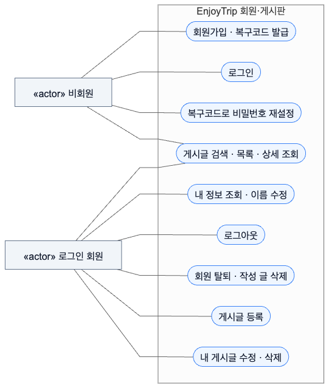

[SVG 확대 보기](Backend/Docs/readme/diagrams/usecase-account-board.svg) · [Mermaid 원본](Backend/Docs/readme/diagrams/usecase-account-board.mmd)

비회원은 가입·로그인·복구코드 재설정과 게시글 조회를 이용합니다. 로그인 회원은 본인 정보와 본인 글을 변경할 수 있습니다. 관리자 역할은 현재 모델에 없습니다.

### 3.2 관광·여행 계획 Usecase Diagram

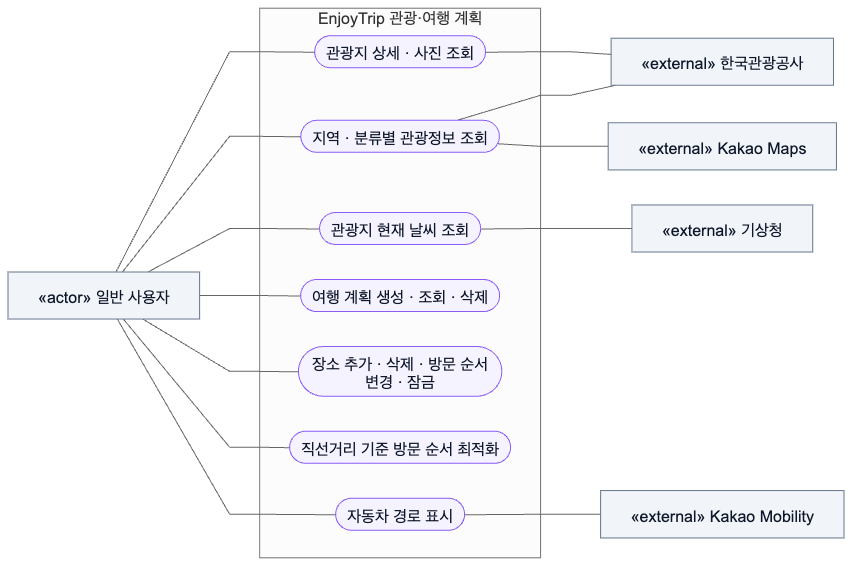

[SVG 확대 보기](Backend/Docs/readme/diagrams/usecase-travel.svg) · [Mermaid 원본](Backend/Docs/readme/diagrams/usecase-travel.mmd)

관광 API는 브라우저에서 직접 호출합니다. 여행 계획은 비회원도 브라우저에 저장할 수 있으며, 현재 날씨와 자동차 경로는 선택 API 키를 사용합니다.

### 3.3 Controller · Service · DAO Class Diagram

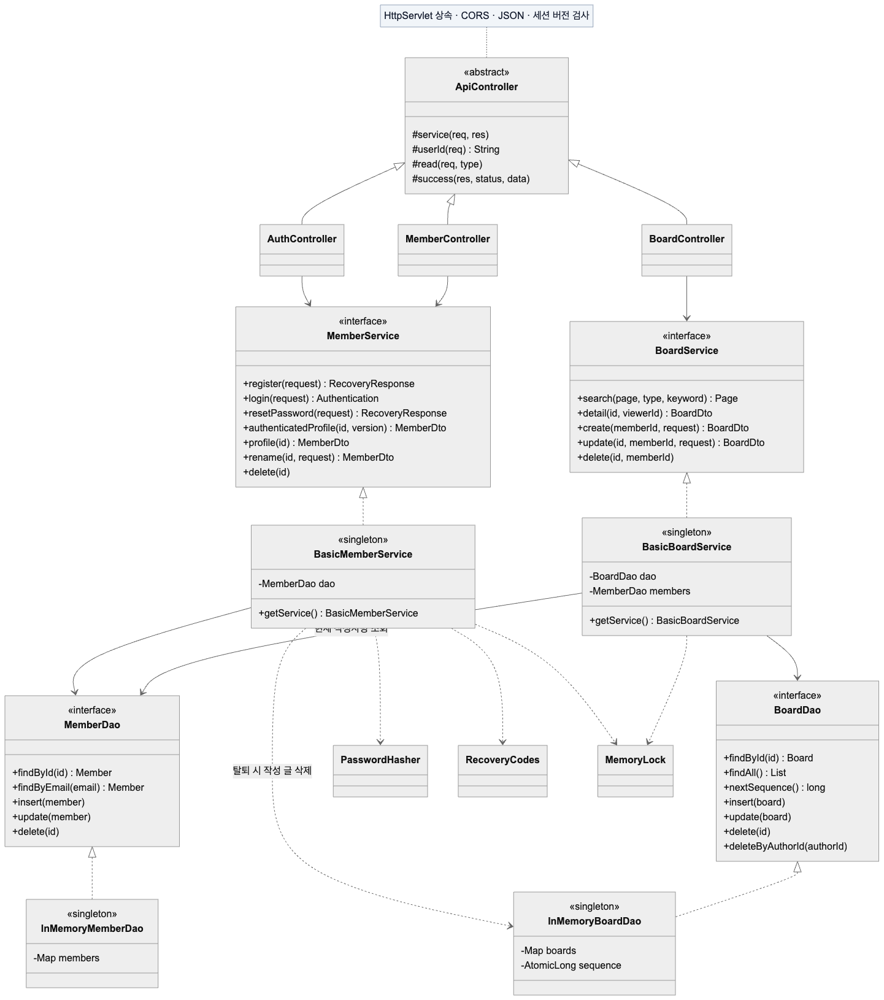

[SVG 확대 보기](Backend/Docs/readme/diagrams/class-layers.svg) · [Mermaid 원본](Backend/Docs/readme/diagrams/class-layers.mmd)

Servlet은 HTTP·JSON·세션을 처리하고 Service는 검증·권한·업무 흐름을 담당합니다. DAO는 저장소 접근을 담당하며 singleton Service/DAO가 공통 잠금을 사용합니다. 그림은 핵심 관계를 보여 주며 생성자·접근자·일부 공통 메서드는 생략했습니다.

### 3.4 엔티티 · 응답 DTO Class Diagram

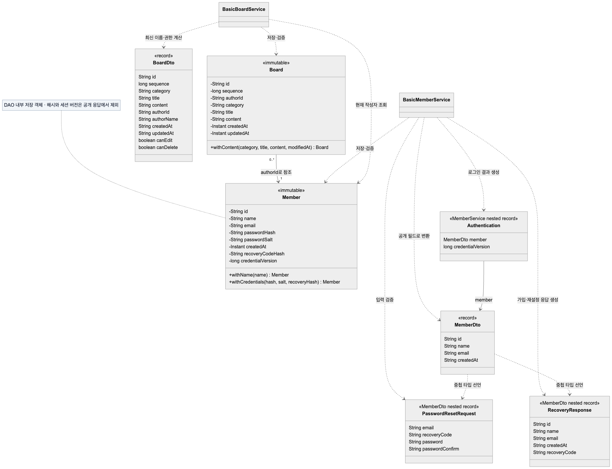

[SVG 확대 보기](Backend/Docs/readme/diagrams/class-models.svg) · [Mermaid 원본](Backend/Docs/readme/diagrams/class-models.mmd)

`Member`와 `Board`는 불변 저장 객체입니다. `Board.authorId`가 `Member.id`를 문자열로 참조하며 DB 외래 키나 Member 객체 필드는 아닙니다. 응답은 별도 DTO로 변환해 비밀번호 해시·salt·복구코드 해시·세션 버전을 숨깁니다. `RecoveryResponse`의 원문 복구코드는 가입·재설정 성공 직후에만 반환합니다. API 입출력의 전체 필드는 실제 [MemberDto](Backend/src/main/java/enjoytrip/model/api/MemberDto.java)·[BoardDto](Backend/src/main/java/enjoytrip/model/api/BoardDto.java)·[CommonDto](Backend/src/main/java/enjoytrip/model/api/CommonDto.java)를 참고합니다.

## 4. 프로젝트 구조

```text
SSAFY_arrowproject_backend/
├── .vscode/                       # Live Server 루트·호스트·포트 및 권장 확장
├── Frontend/
│   ├── pages/                     # map / free-board / my-page / 공통 header·footer
│   ├── css/, resources/            # 화면 스타일·이미지·아이콘
│   ├── js/
│   │   ├── api.js                 # 5500 → 8080 API 요청·세션 쿠키
│   │   ├── auth/                  # 회원 폼·복구코드·모달·인증 상태
│   │   ├── board/                 # 게시판 API·목록·상세·등록·수정
│   │   └── map.js 등              # 관광·지도·계획·경로·날씨
│   ├── tests/                     # node:test와 선택 브라우저 검사
│   ├── config.env.example         # 공개 API 키 템플릿
│   └── config.env                 # 로컬 키 설정 · Git 제외
├── Backend/
│   ├── pom.xml                    # Java 25 Maven WAR
│   ├── src/main/java/enjoytrip/
│   │   ├── controller/            # Auth / Member / Board / 공통 ApiController
│   │   └── model/
│   │       ├── service/           # singleton 서비스·검증·비밀번호/복구코드 처리
│   │       ├── dao/               # DAO 인터페이스·메모리 구현·공통 잠금
│   │       ├── dto/               # Member·Board 저장 객체
│   │       └── api/               # HTTP 요청·응답 record DTO
│   ├── src/main/webapp/           # Servlet·쿠키 설정
│   ├── src/test/java/             # JUnit 서비스 테스트
│   ├── scripts/                   # Tomcat 실행·HTTP 계약 검사
│   ├── Docs/readme/               # README 다이어그램·실행 캡처
│   ├── .runtime/                  # 기존 검증용 Tomcat·원본 캡처 · Git 제외
│   └── target/enjoytrip.war        # 빌드 결과 · Git 제외
└── README.md
```

## 5. 환경 설정과 실행 · STS

Windows에서 **STS로 Backend 프로젝트 가져오기 → 설정 파일 작성 → Tomcat 서버에 프로젝트 등록 → Run on Server → Live Server 실행** 순서로 진행합니다. 백엔드는 STS의 Servers 뷰에서 배포·실행·종료합니다.

### 5.1 준비 도구와 STS의 JDK 설정

저장소 전체를 예를 들어 `C:\work\SSAFY_arrowproject_backend`에 내려받습니다. `Frontend`와 `Backend`의 상대 위치를 유지하고, 아래 예제 경로는 실제 설치 위치에 맞게 바꿉니다.

| 도구 | 준비 내용 |
| --- | --- |
| JDK 25 | JRE가 아닌 JDK를 설치한다. 예: `C:\dev\jdk-25` |
| STS | Java 25·Tomcat 11을 지원하는 Eclipse WTP, Tomcat 서버 어댑터, Maven Integration(m2e·m2e-wtp)을 준비한다. |
| Apache Tomcat 11 | [공식 다운로드](https://tomcat.apache.org/download-11.cgi)에서 Windows용 ZIP을 받아 압축 해제한다. 예: `C:\dev\apache-tomcat-11` |
| VS Code + Live Server | 저장소 루트의 프론트엔드를 5500 포트로 제공한다. |
| 선택 검사 도구 | Node.js, Python 3, Chrome은 9절의 추가 자동 검사를 실행할 때 사용한다. |

STS의 `Window → Preferences → Java → Installed JREs → Add → Standard VM`에서 JDK 25 설치 폴더를 등록하고 기본 JDK로 선택합니다. Maven은 STS에 포함된 런타임을 사용하며 `Window → Preferences → Maven → Installations`에서 확인합니다. 별도 Maven 설치나 터미널 환경 변수 설정 없이 IDE에서 빌드할 수 있습니다. [Eclipse m2e 안내](https://eclipse.dev/m2e/documentation/m2e-faq.html)

### 5.2 프로젝트 가져오기·config.env 설정·WAR 빌드

**Backend 프로젝트 가져오기**

1. `File → Import → Maven → Existing Maven Projects`를 선택합니다.
2. Root Directory에 저장소의 **`Backend` 폴더**를 지정하고 `pom.xml`을 선택한 뒤 **Finish**를 누릅니다.
3. 가져온 백엔드 프로젝트의 `Properties → Java Build Path`에서 JRE System Library가 **JDK 25**인지 확인합니다. 프로젝트 이름은 가져오기 설정에 따라 `Backend` 또는 `enjoytrip`으로 표시될 수 있습니다.
4. 프로젝트를 우클릭해 `Maven → Update Project`를 실행하고 의존성 다운로드가 끝날 때까지 기다립니다. `Project → Build Automatically`를 켜고 Problems 뷰에서 빌드 오류를 확인합니다.

**config.env 작성**

Windows 파일 탐색기 또는 VS Code 탐색기에서 `Frontend/config.env.example`을 복사해 같은 폴더에 **`config.env`**라는 이름으로 저장합니다. 기존 파일이 있으면 해당 파일을 편집합니다. Windows 파일 탐색기에서는 파일 확장명 표시를 켜고 `config.env.txt`로 저장되지 않았는지 확인합니다.

다음 형식으로 작성하고 `YOUR_...` 부분을 실제 발급받은 값으로 바꿉니다. 선택 키는 사용하지 않으면 빈 값으로 둡니다.

```dotenv
DATA_GO_KR_API_KEY=YOUR_TOUR_API_DECODING_KEY
KAKAO_MAP_KEY=YOUR_KAKAO_JAVASCRIPT_KEY
KAKAO_REST_API_KEY=
KMA_SERVICE_KEY=
```

| 변수 | 필수 여부 | 용도·발급 값 |
| --- | --- | --- |
| `DATA_GO_KR_API_KEY` | 지도·관광 검색에 필수 | 공공데이터포털 한국관광공사 국문관광정보의 일반 인증키(Decoding). 코드가 쿼리 값을 인코딩하므로 이미 인코딩한 값을 중복 적용하지 않는다. |
| `KAKAO_MAP_KEY` | 지도·관광 검색에 필수 | Kakao Maps JavaScript 키. 웹사이트 origin `http://127.0.0.1:5500`을 등록한다. |
| `KAKAO_REST_API_KEY` | 선택 | Kakao Mobility 자동차 길찾기에 사용하는 REST API 키. 없거나 호출에 실패하면 방문지를 직선으로 연결한다. |
| `KMA_SERVICE_KEY` | 선택 | 공공데이터포털 기상청 단기예보 조회서비스의 인증키. 현재 날씨는 초단기실황 API로 조회한다. |

키 이름은 위 대문자 이름을 그대로 사용합니다. `Frontend/js/keys.js`가 읽는 파일은 **`Frontend/config.env`**입니다. 관광·지도용 브라우저 API 키를 입력하고 저장합니다. 회원·게시판은 이 키가 없어도 동작합니다. 카카오 JavaScript 키에 등록된 사이트 주소는 **`http://127.0.0.1:5500`**이므로 브라우저에서도 같은 호스트·포트를 사용합니다. `localhost:5500`은 다른 origin입니다.

`config.env`는 브라우저에서 읽을 수 있는 공개 API 키 전용 파일이며 Git에 커밋하지 않습니다. 로컬 WAR에도 포함됩니다. API 제공자의 사용 범위·쿼터 제한을 적용하고 관리자 키·DB 비밀번호·메일 비밀번호 등 서버 비밀값은 넣지 않습니다. Live Server로 실행할 때 키를 수정하면 브라우저를 새로고침합니다. 제출용 WAR에 포함된 복사본도 갱신하려면 STS에서 Maven Build를 다시 실행합니다.

**제출용 WAR 빌드 · STS**

1. 가져온 백엔드 프로젝트를 우클릭해 **`Run As → Maven build...`**를 선택합니다.
2. `Main` 탭에서 **Base directory**가 `pom.xml`이 있는 **`Backend` 폴더**인지 확인하고 **Goals**에 **`clean package`**를 입력합니다. 테스트도 함께 실행되도록 **Skip Tests는 체크하지 않습니다.**
3. `JRE` 탭의 실행 JRE를 **JDK 25**로 지정하고 **Run**을 누릅니다.
4. Console에서 테스트 통과와 **`BUILD SUCCESS`**를 확인합니다. 프로젝트를 **Refresh(F5)**한 뒤 `target/enjoytrip.war`가 생성되었는지 확인합니다.

저장소 기준 결과 경로는 **`Backend\target\enjoytrip.war`**입니다. Maven WAR 설정이 Frontend의 페이지·JS·CSS·리소스를 같은 웹앱에 포함합니다. 제출용 파일을 다시 만들 때는 이 Maven Build 실행 설정을 재사용합니다.

일상적인 개발 실행에서는 다음 절처럼 **프로젝트를 Tomcat 모듈로 등록**합니다. STS가 프로젝트의 클래스·의존성·웹 리소스를 배포하므로, 생성한 WAR를 Tomcat 폴더에 수동 복사하는 단계는 없습니다. 프론트 화면은 Live Server에서 원본 파일을 제공합니다.

### 5.3 프로젝트를 STS의 Tomcat 서버에 등록·실행 · 8080

**서버와 프로젝트 연결**

1. `Window → Preferences → Server → Runtime Environments → Add`에서 **Apache Tomcat 11**을 선택합니다. 설치 경로는 압축을 해제한 폴더(예: `C:\dev\apache-tomcat-11`), 실행 JRE는 **JDK 25**로 지정합니다.
2. 백엔드 프로젝트의 `Properties → Targeted Runtimes`에서 등록한 **Tomcat 11**을 선택합니다.
3. `Window → Show View → Other → Server → Servers`로 Servers 뷰를 열고, 우클릭 **`New → Server`**에서 등록한 Tomcat 11 런타임으로 서버를 만듭니다. `Add and Remove` 단계에서 가져온 **백엔드 프로젝트**를 Configured 목록으로 옮기고 **Finish**를 누릅니다. 기존 서버에 추가할 때는 서버 우클릭 **`Add and Remove...`**를 사용합니다.
4. 서버를 더블클릭해 **HTTP/1.1 포트 8080**, **Tomcat 종료 포트 8081**로 설정하고 저장합니다. `Open launch configuration`에서 실행 JRE가 **JDK 25**인지 확인하고, `Arguments` 탭의 VM arguments에 `-Dfile.encoding=UTF-8`을 추가합니다.
5. 서버 설정의 `Modules` 탭에서 백엔드 모듈의 Path가 **`/enjoytrip`**인지 확인합니다. 다르면 `Edit`로 수정하고 저장합니다.

**실행과 접속 확인**

1. 백엔드 프로젝트를 우클릭해 **`Run As → Run on Server`**를 선택합니다.
2. 앞에서 만든 **Tomcat 11 서버**를 선택하고 **Finish**를 누릅니다. STS가 프로젝트를 서버에 배포하고 실행합니다.
3. Servers 뷰의 서버 상태와 Console의 배포 로그를 확인합니다. [게시판 목록 API](http://127.0.0.1:8080/enjoytrip/api/posts)를 열어 JSON 응답이 나오는지 확인합니다.
4. 5.4에 따라 Live Server를 실행하고 **`http://127.0.0.1:5500/pages/map.html`**에 접속합니다. 프론트 화면에서 회원·게시판 요청을 STS의 Tomcat으로 보냅니다.

`Run on Server`가 연 내부 브라우저 대신 위 API 주소와 Live Server 주소로 확인합니다. 두 번째 실행부터는 Servers 뷰에서 해당 서버를 우클릭해 **Start** 또는 **Debug**를 사용할 수 있습니다. [Eclipse WTP Run on Server](https://eclipse.dev/webtools/wst/components/server/runOnServer.html)

**수정 반영과 종료**

| 작업 | STS에서 수행할 절차 |
| --- | --- |
| Java·웹 리소스 수정 반영 | 파일 저장 → 자동 빌드 완료 확인 → 서버 우클릭 **Publish**. 필요 시 **Restart** |
| `pom.xml` 의존성 변경 | **Maven → Update Project** → 빌드 오류 확인 → **Publish / Restart** |
| 서버 종료 | Servers 뷰의 **Stop** |
| 제출용 WAR 갱신 | 5.2의 **Maven Build → clean package** 재실행 |

Eclipse 메타데이터는 **Java 25 / Dynamic Web Module 6.1**로 맞춰져 있으며, `pom.xml`과 `web.xml`의 **Servlet 6.1** 대상과 일치합니다. 최종 점검에서 설치된 STS의 WTP·Tomcat 11 어댑터가 Web Facet 6.1을 지원하는 것을 확인했습니다. 프로젝트를 이미 가져왔다면 Refresh 후 `Maven → Update Project`를 실행하고 Project Facets도 확인합니다. Tomcat 11이나 Java 25를 선택할 수 없거나 호환성 오류가 나면 STS·WTP·서버 어댑터를 업데이트합니다. Servlet 의존성을 6.0 또는 `javax.servlet`로 바꾸지 않습니다.

STS는 서버 설정의 **Server Locations**에 따라 `CATALINA_BASE`와 배포 위치를 관리합니다. 기본 `Use workspace metadata` 설정에서는 보통 `<워크스페이스>/.metadata/.plugins/org.eclipse.wst.server.core/tmpN`을 사용하며, 실제 경로는 실행 설정의 VM arguments에 있는 `-Dcatalina.base`로 확인합니다. 설치 폴더는 `CATALINA_HOME`이며 로그는 STS의 **Console**에서 확인합니다. 저장소의 `Backend/.runtime`은 기존 검증용 폴더로, STS가 생성한 서버의 배포 경로와 다릅니다.

현재 저장소는 메모리 DAO이므로 서버 재시작·재배포 시 회원과 게시글이 초기화됩니다.

### 5.4 Live Server 프론트엔드 실행 · 5500

1. VS Code에서 **저장소 루트 `SSAFY_arrowproject_backend`**를 폴더로 엽니다.
2. 권장 확장인 **Live Server (`ritwickdey.LiveServer`)**를 설치합니다.
3. `Frontend/pages/map.html`을 열고 우클릭하여 **Open with Live Server**를 선택합니다.
4. 브라우저 주소가 **`http://127.0.0.1:5500/pages/map.html`**인지 확인합니다. 저장소 설정에 의해 `Frontend`가 웹 루트가 됩니다.

접속: [관광 지도](http://127.0.0.1:5500/pages/map.html), [자유게시판](http://127.0.0.1:5500/pages/free-board.html), [마이페이지](http://127.0.0.1:5500/pages/my-page.html)

**STS에서 실행한 Tomcat 8080과 Live Server 5500을 동시에 실행**합니다. 프론트 파일 수정은 Live Server에 바로 반영되며, API 키 설정도 `Frontend/config.env`에서 읽습니다. 회원·게시판 요청과 로그인 쿠키는 STS의 Tomcat이 처리합니다. Live Server 종료는 VS Code 상태 표시줄의 `Port: 5500`을 누릅니다.

## 6. 회원가입과 비밀번호 찾기

1. 회원가입을 완료하면 **복구코드 보관** 창이 열립니다. 코드를 비밀번호 관리자 등 안전한 곳에 보관하고 로그인합니다.
2. 비밀번호를 잊었다면 로그인 창의 **비밀번호 찾기**를 누르고 이메일·복구코드·새 비밀번호·새 비밀번호 확인을 입력합니다.
3. 성공하면 기존 비밀번호와 기존 복구코드가 만료되며, 해당 회원의 모든 기존 로그인 세션도 다음 인증 요청에서 거절됩니다.
4. 새로 발급된 복구코드를 보관하고 새 비밀번호로 다시 로그인합니다. 자동 로그인은 하지 않습니다.

복구코드는 가입·재설정 성공 응답에서만 한 번 반환하고, 서버에는 해시만 저장합니다. 일반 회원 조회·로그인 응답에는 포함하지 않으며 브라우저 저장소에도 저장하지 않습니다. 코드를 잃어버리면 이메일만으로 재설정할 수 없습니다. 메모리 DAO를 사용하는 임시 프로젝트이므로 서버 재시작 시 계정과 복구 정보가 함께 사라집니다.

복구 방식은 사전에 보관한 무작위 코드로 본인을 확인하는 방식입니다. [OWASP 비밀번호 복구 지침](https://cheatsheetseries.owasp.org/cheatsheets/Forgot_Password_Cheat_Sheet.html)을 참고해 코드 해시 저장·일회 사용·새 비밀번호 확인·기존 세션 만료를 적용했습니다.


## 7. API 명세 요약

모든 경로 앞에 `/enjoytrip/api`를 붙입니다. 요청·응답은 UTF-8 JSON이고 삭제·로그아웃 성공은 빈 204 응답입니다.

| Method | 경로 | 기능 |
| --- | --- | --- |
| POST | /members/register | 가입 |
| POST | /auth/login | 로그인 |
| POST | /auth/logout | 로그아웃 |
| POST | /auth/password-reset | 복구코드로 비밀번호 재설정·새 코드 발급 |
| GET | /members/me | 내 정보·로그인 상태 |
| PUT | /members/me | 이름 수정 |
| DELETE | /members/me | 탈퇴·글 삭제 |
| GET | /posts?page=1&type=all&keyword= | 검색·페이징 |
| GET | /posts/{id} | 상세 |
| POST | /posts | 등록 |
| PUT | /posts/{id} | 수정 |
| DELETE | /posts/{id} | 삭제 |

회원가입과 비밀번호 재설정 응답은 공개 회원 필드와 `recoveryCode`를 반환합니다. 일반 로그인·내 정보 조회·수정 응답에는 복구코드가 없습니다. 상세 계약은 [비밀번호 복구 API](Backend/Docs/비밀번호_복구_API.md)와 [기존 최소 API 명세](https://www.notion.so/40919c9b9e0b80158b3deaf34f1974dc)를 참고합니다. 복구코드 추가 이후 계약은 이 README와 로컬 문서가 기준입니다.

직접 HTTP 클라이언트를 사용할 때 변경 요청에는 `X-Requested-With: EnjoyTrip`을 지정합니다. 본문이 있으면 `Content-Type: application/json`도 필요합니다. Origin은 위 Live Server 허용 주소 또는 백엔드 자신과 같은 origin이어야 합니다. 그 외 origin과 변경 요청의 cross-site 접근은 거절합니다. 허용 주소를 응답에 명시하고 `Access-Control-Allow-Credentials: true`를 사용하며 `*`는 사용하지 않습니다. 브라우저는 `credentials: "include"`로 HttpOnly JSESSIONID 쿠키를 전송합니다. 같은 호스트에서 포트만 다르게 사용하므로 SameSite=Lax를 유지합니다. [CORS와 자격 증명 참고](https://developer.mozilla.org/en-US/docs/Web/HTTP/Guides/CORS). 알 수 없는 JSON 필드는 400이고, 클라이언트가 작성자나 권한을 지정할 수 없습니다.


## 8. 실행 결과 · 스크린샷

아래 이미지는 실제 실행·검증 화면입니다. 회원·게시판은 테스트용 계정과 게시글을 사용했으며 검사 후 정리했습니다. 원본 검증 캡처에서 README용 파일을 `Backend/Docs/readme/screenshots/`에 복사해 저장했으므로 Git에서 함께 볼 수 있습니다.

### 8.1 지역·분류별 관광정보 검색

Live Server의 지도에서 서울특별시 → 종로구 → 역사관광을 검색해 66곳의 결과와 지도 마커·클러스터를 확인했습니다.

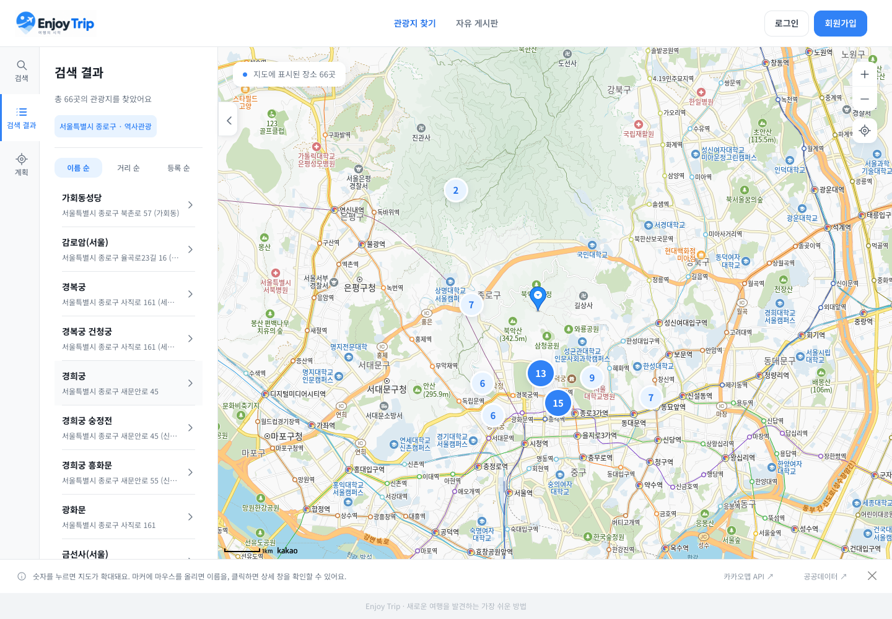

### 8.2 자유게시판 목록·검색·페이징

Tomcat의 실제 게시글 데이터를 조회한 화면입니다. 검색 조건 유지, 페이지당 7건과 마지막 페이지, 빈 결과를 자동 검사했습니다.

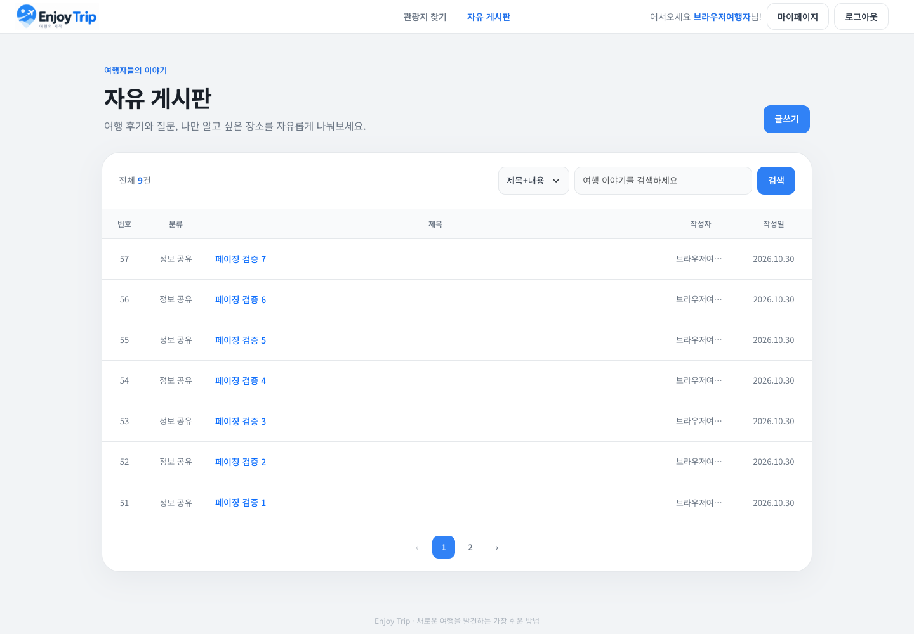

### 8.3 본인 회원정보 조회·이름 수정

로그인 세션으로 본인 정보를 조회하고 이름을 변경한 화면입니다. 기존 글의 작성자명도 최신 이름으로 반영됩니다.

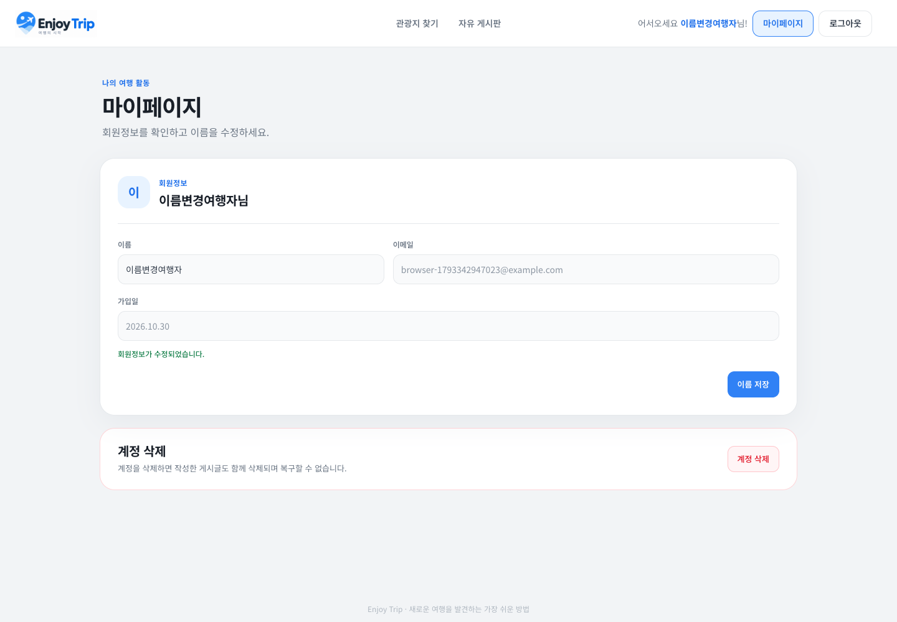

### 8.4 복구코드로 비밀번호 찾기

가입 시 보관한 코드를 입력해 비밀번호를 재설정합니다. 입력 오류·사용한 코드 재사용 거절·새 코드 발급·기존 세션 만료·새 비밀번호 로그인까지 검증했습니다. 캡처의 코드와 비밀번호 입력은 마스킹되어 있습니다.

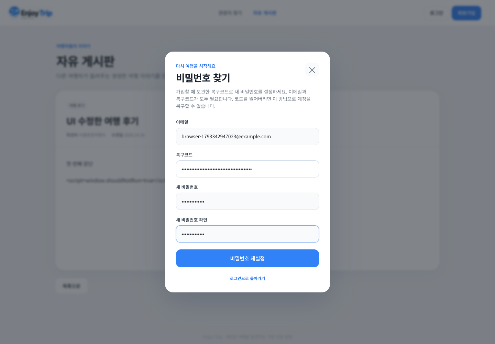

### 8.5 여행 계획과 자동차 경로

별도로 생성한 검증용 여행에 경복궁·경희궁을 담고 방문 순서를 최적화한 뒤 실제 자동차 경로를 표시한 캡처입니다. 여행 계획은 브라우저에 저장합니다.

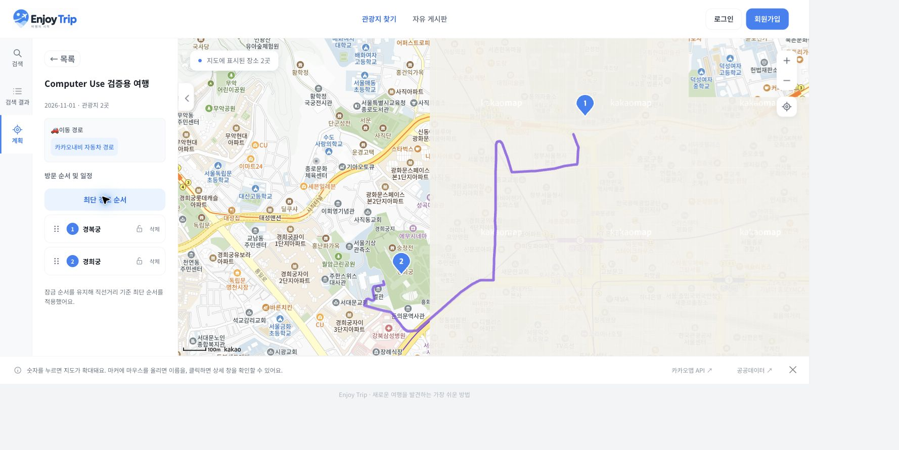

### 8.6 모바일 화면 · 390px

<details>
<summary>모바일 게시판과 비밀번호 찾기 화면 보기</summary>

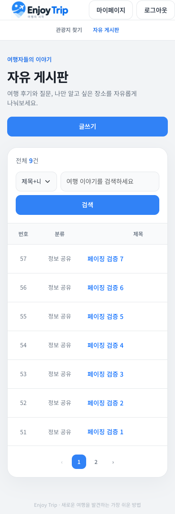

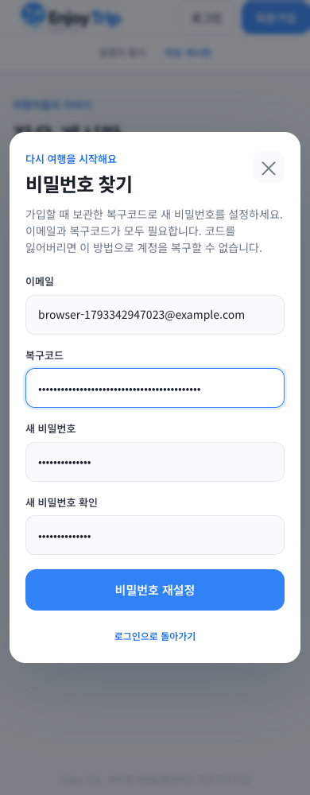

</details>

## 9. 검증 결과와 테스트

### 9.1 확인한 결과

검증일은 **2026-10-30**, 환경은 **macOS · JDK 25 · Tomcat 11.0.27 · Chrome**입니다. 프론트는 설치된 VS Code Live Server 5.7.10의 서버 엔진을 동일 설정(Frontend 루트, 127.0.0.1:5500)으로 실행했습니다. 이 결과는 기존 검증 환경에서 얻은 것이며, README의 STS 화면 조작·서버 배포와 Windows 실환경 실행은 별도 검증하지 않았습니다.

| 검증 | 결과 | 확인 범위 |
| --- | --- | --- |
| Maven 서비스 테스트 | 12개 통과 | 회원·게시판 서비스, 동시성, 코드 회전·기존 세션 만료 |
| Maven WAR 패키징 | 성공 | JDK 25 WAR 빌드, Servlet/JSP API provided·JSTL 포함 |
| 프론트 `node:test` | 78개 통과 | API 주소·쿠키, 지도·검색·경로·여행 계획·상세 화면 회귀 |
| 실제 HTTP 검사 | 105건 통과 | 12개 API, UTF-8, CORS, 세션, 권한, 검색/페이징, 비밀번호 복구 |
| Chrome 브라우저 검사 | 통과 | 가입·로그인·새로고침·글 CRUD·검색·이름 변경·탈퇴·복구 |
| 화면·키보드 | 통과 | 1440/820/390px, 모달 Tab·Escape·임시 비밀 입력 삭제 |
| 관광 API 실조회 | 7개 분류 통과 | 종로구 관광지 66·숙박 88·음식점 187·문화관광 213·공연 38·쇼핑 217건, 전국 추천코스 1,068건 |
| 기존 관광 부가 흐름 | 확인 | 경복궁 상세·사진·현재 날씨, 계획 2곳 저장·최적화·자동차 경로 |

현재 위치 권한을 사용하는 내 주변 검색의 실제 위치 기반 조회, 모든 지역·관광지 데이터의 전수 확인, 성능 SLA·모든 디바이스 호환성은 이번 검증에 포함하지 않았습니다. 로컬 게시판 목록 20회는 중앙값 0.66ms·P95 1.44ms였으며, 전체 측정 조건과 미완료 사항은 [최종 검증 결과](Backend/Docs/최종_검증_결과.md)를 참고합니다.

### 9.2 STS에서 백엔드 테스트·빌드 확인

백엔드 프로젝트를 우클릭해 `Run As → Maven build...`를 열고 **Goals에 `test`**, **JRE에 JDK 25**를 지정해 실행합니다. Console에서 테스트 결과와 `BUILD SUCCESS`를 확인합니다. WAR까지 검사하려면 5.2의 **Goals `clean package`** 실행 설정을 사용합니다.

서버 동작은 5.3의 **Run on Server**로 배포한 뒤 게시판 목록 API와 Live Server의 회원·게시판 화면에서 확인합니다.

### 9.3 추가 자동 검사 · 선택

다음 명령은 프론트 회귀·HTTP·브라우저 검사를 위한 선택 도구입니다. 서버 실행은 5.3의 STS 절차를 따릅니다. Windows PowerShell에서 먼저 저장소 루트로 이동합니다. HTTP 검사에는 **STS의 Tomcat 8080**, 브라우저 검사에는 **Tomcat 8080과 Live Server 5500**이 실행 중이어야 합니다.

```powershell
Set-Location "C:\work\SSAFY_arrowproject_backend"

# Node.js 설치 시: PowerShell에서 테스트 파일 경로를 배열로 전달합니다.
$testFiles = Get-ChildItem .\Frontend\tests\*.test.js | ForEach-Object { $_.FullName }
node --test $testFiles

# Python 3와 Windows Python Launcher 설치 시
py -3 .\Backend\scripts\check_api.py
```

`py`가 없다면 Python 3의 `python` 명령으로 바꿔 실행합니다. `check_api.py`는 12개 API의 한글 왕복, 세션 ID 갱신/쿠키, 중복 가입, 검증 오류, 작성자 권한, 정렬/검색/페이징, 이름 반영, 탈퇴 연계, 복구코드 교체·재사용 거절과 재설정 후 기존 세션 만료를 검증합니다. 고유한 테스트 회원을 만들고 종료 시 정리합니다. 기본 API 검사 주소는 `http://127.0.0.1:8080/enjoytrip`이며 Live Server origin을 보내 CORS 응답·사전 요청·세션도 함께 검증합니다.

Chrome과 Node.js/npm이 설치되어 있으면 선택적으로 브라우저 검사도 실행할 수 있습니다. Playwright는 임시 폴더에 설치하고 Windows Chrome 경로를 명시합니다.

```powershell
$browserTools = Join-Path $env:TEMP "enjoytrip-browser-tools"
npm install --prefix "$browserTools" playwright
$env:NODE_PATH = Join-Path $browserTools "node_modules"
$env:CHROME_PATH = "C:\Program Files\Google\Chrome\Application\chrome.exe"
$env:ENJOYTRIP_BASE_URL = "http://127.0.0.1:5500"
$env:ENJOYTRIP_API_BASE_URL = "http://127.0.0.1:8080/enjoytrip"
node .\Frontend\tests\browser-smoke.cjs
```

Chrome 설치 위치가 다르면 `CHROME_PATH`를 실제 `chrome.exe` 경로로 수정합니다. 스크립트 내부 기본값은 macOS 경로이므로 Windows에서는 이 변수를 지정해야 합니다.

브라우저 검사는 회원가입·로그인·새로고침 세션·글 작성/수정/삭제·다른 브라우저 조회·검색/페이징·이름 변경·로그아웃·탈퇴, 작성 중 세션 만료 후 로그인 복구, 오류 후 재시도, 모달 Escape/포커스 복원을 확인합니다. 1440/820/390px 캡처는 `Backend\.runtime\screenshots`에 저장됩니다. 지도 API 키를 비운 상황에서도 회원 모달이 열리는지 별도로 확인합니다. 실제 관광 API 결과는 키와 허용 origin 및 외부 서비스 상태에 따라 달라집니다.


## 10. 문제 해결과 제출 자료

### 자주 확인할 설정

| 증상 | 확인 사항 |
| --- | --- |
| Live Server 화면이 비어 있음 | 저장소 루트를 VS Code로 열고 `Frontend/pages/map.html`에서 실행한다. `index.html`은 관광 화면 진입 파일이 아니다. |
| 지도 SDK 401·지도 로드 실패 | JavaScript 키 종류, Kakao Maps 사용 설정, 등록 origin `http://127.0.0.1:5500`을 확인한다. `localhost`나 다른 포트는 별도 origin이다. |
| 회원·게시판 ‘서버에 연결하지 못했습니다’ | STS의 Tomcat 8080 실행·enjoytrip 모듈 추가·context path `/enjoytrip`·호스트 일치를 확인한다. |
| `config.env` 404 | 파일 위치가 `Frontend/config.env`인지, Live Server 루트가 `Frontend`인지 확인한다. |
| Java release 25 빌드 오류 | STS의 Installed JREs·프로젝트 JRE·Maven Build의 JRE 탭을 JDK 25로 맞춘다. Tomcat 실행 JRE도 확인한다. |
| Run on Server가 없거나 서버에 프로젝트 추가 불가 | Maven 프로젝트로 가져왔는지, WTP·m2e-wtp 설치, Project Facets·Targeted Runtimes의 Tomcat 11 설정을 확인한다. |
| API가 404이거나 의존성 클래스를 찾지 못함 | 서버의 모듈 등록·Path `/enjoytrip`을 확인한다. Maven Update Project 후 Deployment Assembly의 Maven Dependencies(`/WEB-INF/lib`)와 Publish 상태를 확인한다. |
| 포트 충돌 | 5500은 Live Server, 8080은 STS의 Tomcat으로 사용한다. 같은 포트를 사용하는 다른 서버를 종료한다. |
| 서버 재시작 후 계정·글이 없음 | 현재 저장 방식은 메모리 DAO다. 새로 회원가입해야 한다. |
| 복구코드 분실 | 코드 원문은 다시 조회할 수 없다. 가입·재설정 직후 안전한 곳에 보관한다. |

### 참고·제출 문서

- [프로젝트 원문 PDF](Backend/Docs/자바전공_enjoytrip_16_05_백엔드.pdf)
- [필수사항 체크리스트](Backend/Docs/필수사항_체크리스트.md)
- [최종 검증 결과와 남은 확인 사항](Backend/Docs/최종_검증_결과.md)
- [비밀번호 복구 API 상세](Backend/Docs/비밀번호_복구_API.md)
- [기존 요구사항 분석](https://www.notion.so/40919c9b9e0b80ecbe49e7e87a13b7a4) · [기존 최소 API·DTO 설계](https://www.notion.so/40919c9b9e0b80158b3deaf34f1974dc)
- [README용 다이어그램 원본·이미지](Backend/Docs/readme/diagrams/) · [실행 캡처](Backend/Docs/readme/screenshots/)

Notion의 초기 요구사항에는 이후 보류한 기능이 포함되어 있습니다. 현재 구현 범위와 복구코드 추가 후 계약은 이 README와 로컬 소스를 기준으로 확인합니다. PDF에 지정된 GitLab 업로드·반별 제출 방식은 별도 제출 단계에서 확인해야 합니다.
